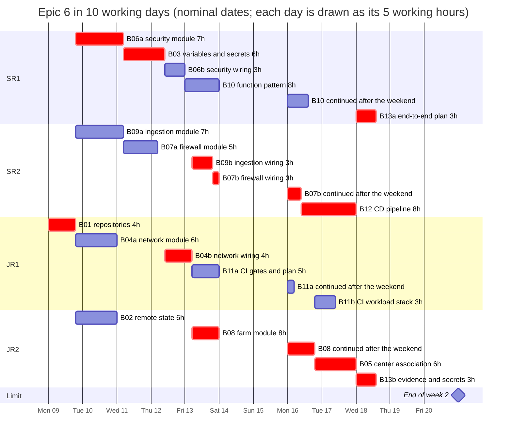
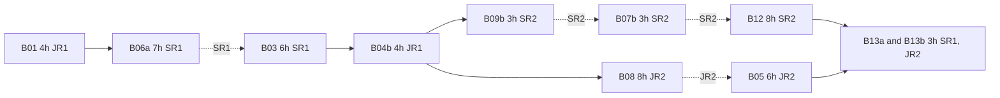

# 100-Hour Plan for Epic 6

| Field | Value |
|---|---|
| Status | Proposed |
| Date | 2026-11-04 |
| Owner | SR1 / SR2 |
| Roadmap issue | aroma-pacifico/aroma-pacifico-roadmap#20 (A20) |
| Plans | B01 to B13, aroma-pacifico/aroma-pacifico-roadmap#21 to aroma-pacifico/aroma-pacifico-roadmap#33 (track B, Epic 6) |
| Builds on | [ADR-003](adr/adr-003-iac-tool-remote-state-and-pattern-module.md), [architecture](architecture.md#14-diagram-boxes-d01-to-d13-and-traceability-to-the-iac) sections 10, 14 and 17.3, [automation and pipelines](automation-and-pipelines.md#1-purpose-and-requirements), [release notes](release-notes/README.md) |
| Decision-log entries | ASM-210 to ASM-217, PD-210; closes PD-078 and PD-175; PD-181 stays open for B01 |

## 1. Purpose and requirements

The [case statement](case/case-statement.pdf) bounds the infrastructure code more tightly than any other deliverable: "La implementación de infraestructura como código cabe en 2 semanas y en 100 horas. El alcance de ese esfuerzo es el código: módulos, variables, estado remoto y un plan ejecutable de un ambiente." Epic 6 is "Única épica medida en las 100 horas y en las 2 semanas", and delivery task 2 asks for "Plan de 100 horas. Solo las tareas de la épica 6, con horas, responsable y orden. La suma no pasa de 100 ni de 2 semanas. Cada tarea apunta a una caja del diagrama que el código implementa." Evaluation criterion 3 repeats that the code "suma máximo 100 horas y cabe en 2 semanas", and the defense must sustain "por qué el código de infraestructura cabe en 100 horas". Quotations are in the original Spanish, which prevails over the English rendering (ASM-001).

This plan takes the thirteen Epic 6 tasks of the roadmap, their planning estimates, owners and "Blocked by" lists, and turns them into an ordered, resource-leveled schedule for the four roles SR1, SR2, JR1 and JR2 (ASM-009). It writes no Terraform: the code lives in `aroma-pacifico-terraform-modules` and `aroma-pacifico-infrastructure` (`AGENTS.md` section 5). No hour in this document is a measurement; every figure is a planning estimate from the roadmap or arithmetic on those estimates and on the capacity assumption ASM-210.

| Acceptance criterion of aroma-pacifico/aroma-pacifico-roadmap#20 | Where it is met |
|---|---|
| The plan includes only Epic 6 within the 100 hours. | Section 2 |
| Each IaC task has an owner, order, dependency and associated diagram box. | Section 4.1, with inputs in 4.2 and done criteria in 4.3 |
| No individual task exceeds 10 hours. | Sections 4.1 and 9 |
| The total does not exceed 100 hours and fits in 2 weeks with 4 people. | Sections 6 and 9 |

## 2. Scope: what counts in the 100 hours

Only the thirteen issues of track B count, because they are the only work items labeled `epic:E6` that produce code. Everything the case statement places outside the 100 hours ("Quedan fuera arquitectura, estimación de costo, sistema de diseño, release notes y sustentación"; "Observabilidad, SLO y las dos plantillas de release notes se entregan con el proyecto. No forman parte de las 100 horas") is listed below so that no hour of it is counted, and so that no Epic 6 task quietly absorbs it.

| Work | Inside the 100 hours | Where it is done instead |
|---|---|---|
| B01 to B13 (aroma-pacifico/aroma-pacifico-roadmap#21 to #33): repositories, remote state, variables and secrets, network, center association, security, firewall rules, farm module, ingestion pattern, function pattern, CI, CD, final validation | Yes, 98 hours | This plan |
| Landing zone: AWS Organization, OUs, SCPs, tag policy, budgets, cost categories, anomaly detection, organization trail and audit archive | No (PD-078 closed here) | Designed in the [landing zone](landing-zone.md#2-organization-structure); not coded in this delivery. The plan assumes the `qa` account that the plan reads exists, provisioned by a human (PD-019). |
| Track A design tasks A01 to A19, including the architecture document and the complete diagram | No | This repository and `aroma-pacifico-diagrams` |
| This plan (A20) | No | This document |
| Observability and the two SLOs (A21), release notes templates (A22) | No | aroma-pacifico/aroma-pacifico-roadmap#34, aroma-pacifico/aroma-pacifico-roadmap#35 |
| Cost document (A23), design system (A24), presentation and defense (A25) | No | aroma-pacifico/aroma-pacifico-roadmap#36 to #38 |
| The 200 farms, the three collection centers, Buenaventura, the other three inference functions, the sack lookup module, Cognito user pools, application and function code, CodeDeploy deployments | No | Architecture only ([architecture](architecture.md#10-component-inventory) section 10, rows with a dash; ASM-214) |

**PD-078 is closed.** No Epic 6 task codes the AWS Organization, its SCPs, its tag policy, its budgets or its organization trail. The landing zone stays a design; no roadmap task codes it in this delivery, and coding it later would be a separate task outside the 100 hours. The `state` KMS key and the state buckets of each environment are not landing zone: they are Epic 6 work of B02 (ASM-213).

## 3. Planning assumptions

The case statement fixes hours and weeks but not daily availability, calendar, how a task may be split, or what an estimate includes. Each of those is recorded as an assumption so that the arithmetic of sections 6 and 9 can be checked.

| ID | Assumption | Why it is needed |
|---|---|---|
| ASM-210 | Each of the four people gives Epic 6 at most 5 hours per working day, 25 hours per week and 50 hours in the two weeks; team capacity is 200 hours, of which the plan books 98. Time not booked on Epic 6 goes to work outside the 100 hours (A21 to A25). | The dependency chain, not the total, sets the duration; section 6.5 shows that the plan needs at least 3.8 hours per day. |
| ASM-211 | "2 semanas" means 10 working days, Monday to Friday. Day 1 is the first working day after this plan is merged, the two IaC repositories exist, and PD-200 has reported or the lead has recorded the decision to start without it. The dates in the chart of section 6.3 are nominal (Day 1 drawn as Monday 2026-11-09) and each working day's 5 hours are drawn spread over the whole calendar day, so the time of day in the chart is not a commitment. | A chart needs dates; the plan is in working days. |
| ASM-212 | B04, B06, B07 and B09 are each split into a module part, coded in `aroma-pacifico-terraform-modules` and verified with plan-mode tests on mock providers (PC-IAC-018), which needs only B01 and its design input, and a wiring part, coded in the root stack of `aroma-pacifico-infrastructure`, which needs the stacks whose outputs it reads. B11 is split into the gates and `qa` plan of the network and security stacks (B11a) and their extension to the workload stack (B11b). B13 is split between its two roadmap owners so that both halves run in parallel. Owners and the hours of every issue are unchanged; an issue closes when all its parts are merged. | Without the splits the chain B01, B02, B03, B04, B09, B11, B12, B13 is 58 hours and SR2 starts only after B06, so the plan does not fit in 10 days at any availability below 6 hours a day (section 5). |
| ASM-213 | The `state` customer-managed key is created with the state buckets in `stacks/state-backend` by B02, in box D02. The other key classes, the IAM roles and the permission sets stay in D06 as ASM-200 records. | ADR-003 declares "The bucket and its key" in the bootstrap stack, whose own state moves into the bucket it creates; the security stack cannot hold the key that encrypts its own state. |
| ASM-214 | The Epic 6 pipelines code only the infrastructure path of ADR-003: the pull request gates and the saved `qa` plan (B11), and the `pdn` job that applies the reviewed saved plan after a named human approval and refuses a harvest-week window (B12). The CodeDeploy canary of function versions, the coded notice check and the `pdn` job's reading of the release note (ASM-182) stay architecture; B12 documents how the change owner notifies the Federation and how a change is rolled back, as its criteria ask. | Closes PD-175 (section 7). |
| ASM-215 | B01 creates `release-notes/` at the root of `aroma-pacifico-infrastructure`, with a README that points to the templates of [release notes](release-notes/README.md) and to ASM-180, inside its 4 hours. | PD-181 asks the layout to reserve the folder; it is part of B01's done criterion. |
| ASM-216 | The 2 hours between the 98 booked and the 100 allowed are an unallocated reserve held by SR1 and SR2 for rework from the risks of section 8. It may not be drawn by B04, B06 or B09, which are already at 10 hours. | No task may exceed 10 hours and the total may not exceed 100. |
| ASM-217 | Each estimate covers the whole task to merge: authoring, local verification, the pull request and its review. A successor starts only after its predecessors are merged. Each person works one task at a time, the one with the longest remaining chain first. | The schedule of section 6 is computed with these rules. |

## 4. Tasks

### 4.1 Owners, hours, order, dependencies and boxes

The order is the start order in the leveled schedule of section 6; parts that start in the same hour are ordered by ID. "Depends on" lists merged predecessors; the track A inputs (A04, A07, A09 to A12, A16 to A18) are all closed on 2026-11-04 and are met on Day 1. Day columns are working days (ASM-211).

| Order | ID | Issue | Task | Owner | Hours | Depends on | Box | Start | End |
|---|---|---|---|---|---|---|---|---|---|
| 1 | B01 | aroma-pacifico/aroma-pacifico-roadmap#21 | Initialize both IaC repositories: layout of modules, stacks, environments and workflows, `main` protection, README, `release-notes/`, box references | JR1 | 4 | A20, A04 | D01 | Day 1 | Day 1 |
| 2 | B02 | aroma-pacifico/aroma-pacifico-roadmap#22 | Remote state: `stacks/state-backend` with one bucket and one `state` key per environment, native locking, partial backend | JR2 | 6 | B01, A04 | D02 | Day 1 | Day 2 |
| 3 | B04a | aroma-pacifico/aroma-pacifico-roadmap#24 | Network module: VPC, eight tiers, route tables, network ACLs, endpoints, outputs, tests | JR1 | 6 | B01, A07 | D04 | Day 1 | Day 2 |
| 4 | B06a | aroma-pacifico/aroma-pacifico-roadmap#26 | Security baseline module: key classes except `state`, service and pipeline roles, MFA parameters, revocation hooks, tests | SR1 | 7 | B01, A09 | D06 | Day 1 | Day 3 |
| 5 | B09a | aroma-pacifico/aroma-pacifico-roadmap#29 | Telemetry ingestion module: IoT policy, topic rule with DynamoDB and SQS actions, telemetry table, error queue, log group, tests | SR2 | 7 | B01, A04, A16 | D09 | Day 1 | Day 3 |
| 6 | B03 | aroma-pacifico/aroma-pacifico-roadmap#23 | Per-environment variables and secrets: `qa` and `pdn` `.tfvars` and backend files, ephemeral and write-only pattern, example and guide | SR1 | 6 | B01, B02, A04 | D03 | Day 3 | Day 4 |
| 7 | B07a | aroma-pacifico/aroma-pacifico-roadmap#27 | Firewall rules module: permanent cloud rules with validity metadata, tests | SR2 | 5 | B01, A12 | D07 | Day 3 | Day 4 |
| 8 | B04b | aroma-pacifico/aroma-pacifico-roadmap#24 | Network stack wiring for `qa` and `pdn` | JR1 | 4 | B02, B03, B04a | D04 | Day 4 | Day 5 |
| 9 | B06b | aroma-pacifico/aroma-pacifico-roadmap#26 | Security stack wiring for `qa` and `pdn`, identifiers published as SSM parameters | SR1 | 3 | B03, B06a | D06 | Day 4 | Day 4 |
| 10 | B10 | aroma-pacifico/aroma-pacifico-roadmap#30 | Inference function pattern: threshold function, queue, dead-letter queue, event source mapping, read, write and invoke grants | SR1 | 8 | B06b, A17 | D10 | Day 5 | Day 6 |
| 11 | B08 | aroma-pacifico/aroma-pacifico-roadmap#28 | Farm module: one pattern farm, IoT thing, certificate from a CSR, policy attachment, `FarmId` | JR2 | 8 | B04b, A10 | D08 | Day 5 | Day 6 |
| 12 | B09b | aroma-pacifico/aroma-pacifico-roadmap#29 | Ingestion wiring in the workload stack | SR2 | 3 | B04b, B06b, B09a | D09 | Day 5 | Day 5 |
| 13 | B11a | aroma-pacifico/aroma-pacifico-roadmap#31 | CI: gates on every pull request and the saved `qa` plan of the network and security stacks | JR1 | 5 | B02, B03, B04b, B06b | D11 | Day 5 | Day 6 |
| 14 | B07b | aroma-pacifico/aroma-pacifico-roadmap#27 | Firewall rules wiring against the network and security outputs | SR2 | 3 | B04b, B06b, B07a | D07 | Day 5 | Day 6 |
| 15 | B12 | aroma-pacifico/aroma-pacifico-roadmap#32 | CD: promotion `qa` to `pdn`, approval on the saved plan, harvest-week window, notice and rollback documented | SR2 | 8 | B11a, A18 | D12 | Day 6 | Day 7 |
| 16 | B05 | aroma-pacifico/aroma-pacifico-roadmap#25 | Association of the environment with one pattern collection center | JR2 | 6 | B04b, A11 | D05 | Day 6 | Day 7 |
| 17 | B11b | aroma-pacifico/aroma-pacifico-roadmap#31 | CI extended to the workload stack (farm, ingestion, function) | JR1 | 3 | B08, B09b, B10, B11a | D11 | Day 6 | Day 7 |
| 18 | B13a | aroma-pacifico/aroma-pacifico-roadmap#33 | End-to-end executable plan of `qa` and closure of scope, exclusions and steps | SR1 | 3 | B05, B07b, B08, B09b, B10, B11b, B12 | D13 | Day 8 | Day 8 |
| 19 | B13b | aroma-pacifico/aroma-pacifico-roadmap#33 | No-secret validation of repositories and state, and evidence mapped to D01 to D13 | JR2 | 3 | B05, B07b, B08, B09b, B10, B11b, B12 | D13 | Day 8 | Day 8 |
| | | | **Total** | | **98** | | | | |

### 4.2 Inputs and pending decisions

Each issue builds from the documents and sections that [architecture](architecture.md#14-diagram-boxes-d01-to-d13-and-traceability-to-the-iac) section 14 names for its box, and must close or respect the pending decisions listed there and in section 17.3. PD-200, the live re-check of the AWS and GitHub features, must report before B04, B06, B09, B10 and B12 are coded, as the decision log states. Because the module parts B04a, B06a and B09a start on Day 1, Day 1 also waits for PD-200 to report, or for the lead to record the decision to start without it (ASM-211).

| Issue (parts) | Box | Builds from | Pending decisions to close or respect |
|---|---|---|---|
| B01 | D01 | [ADR-003](adr/adr-003-iac-tool-remote-state-and-pattern-module.md#repository-layout) Tool and versions, Repository layout, Compliance with the binding Terraform rules; [automation and pipelines](automation-and-pipelines.md#31-repositories-and-triggering-paths) section 3.1; [release notes](release-notes/README.md) section 4 | PD-170 (respect), PD-181 (close) |
| B02 | D02 | [ADR-003](adr/adr-003-iac-tool-remote-state-and-pattern-module.md#remote-state) Remote state; [landing zone](landing-zone.md#2-organization-structure) section 2; [security and identity](security-and-identity.md#73-key-ownership-and-rotation) section 7.3 | PD-019 |
| B03 | D03 | [ADR-003](adr/adr-003-iac-tool-remote-state-and-pattern-module.md#secrets-out-of-the-repository-and-out-of-the-state) Secrets; [automation and pipelines](automation-and-pipelines.md#11-secrets-out-of-the-repository-and-out-of-the-state) section 11; [landing zone](landing-zone.md#51-keys) section 5.1 | PD-070 |
| B04 (B04a, B04b) | D04 | [Addressing plan](addressing-plan.md#4-subnet-layout-inside-each-environment-vpc) sections 3, 4 and 4.3; [firewall policy](firewall-policy.md#52-policy-table) CL-LNK-07, CL-APP-03, CL-DRN-04, CL-ADM-04, CL-PUB-04, CL-DAT-01 to 03, CL-EGR-01, CL-DEF-02; [drone service](drone-service.md#9-ingress-endpoints-of-the-ground-station-pd-121) section 9; [sack and trip](sack-and-trip.md#72-front-door-cloudfront-no-load-balancer-closes-pd-051) section 7.2 | PD-050, PD-120, PD-122, PD-123, PD-140 |
| B05 | D05 | [Connectivity](connectivity.md#9-collection-center-wan) section 9; [collection-center network](collection-center-network.md#2-one-pattern-three-centers) section 2; [firewall policy](firewall-policy.md#51-enforcement-mechanisms) section 5.1, CL-LNK-01 to 06, CL-ADM-01; [landing zone](landing-zone.md#51-keys) section 5.1 | PD-072, PD-122 |
| B06 (B06a, B06b) | D06 | [Security and identity](security-and-identity.md#2-kinds-of-identity) sections 2, 4.3, 5.3, 6, 7.2 and 7.3; [inference functions](inference-functions.md#11-epic-6-function-pattern) section 11; [ADR-003](adr/adr-003-iac-tool-remote-state-and-pattern-module.md#ci-and-cd-constraints) CI and CD constraints | PD-103, PD-165 |
| B07 (B07a, B07b) | D07 | [Firewall policy](firewall-policy.md#52-policy-table) section 5.2 (rules marked Permanent) and section 6 | PD-122, PD-125 (respect) |
| B08 | D08 | [Connectivity](connectivity.md#41-field-equipment) sections 4.1 and 4.3; [ADR-003](adr/adr-003-iac-tool-remote-state-and-pattern-module.md#pattern-module-telemetry-ingestion) Pattern module; [security and identity](security-and-identity.md#6-device-identities) section 6; [landing zone](landing-zone.md#51-keys) section 5.1 | PD-071 |
| B09 (B09a, B09b) | D09 | [ADR-003](adr/adr-003-iac-tool-remote-state-and-pattern-module.md#pattern-module-telemetry-ingestion) Pattern module; [inference functions](inference-functions.md#3-the-four-triggers) section 3; [farm monitoring](farm-monitoring.md#3-load) sections 3 and 6.6; [landing zone](landing-zone.md#72-event-by-event-design) section 7.2 | PD-016, PD-021, PD-073, PD-161 |
| B10 | D10 | [Inference functions](inference-functions.md#11-epic-6-function-pattern) sections 11, 4.5, 6.1 and 7; [farm monitoring](farm-monitoring.md#5-evaluation-of-a-reading) section 5 | PD-161, PD-018 |
| B11 (B11a, B11b) | D11 | [ADR-003](adr/adr-003-iac-tool-remote-state-and-pattern-module.md#ci-and-cd-constraints) CI and CD constraints; [automation and pipelines](automation-and-pipelines.md#42-gates) section 4.2 | PD-019 |
| B12 | D12 | [ADR-003](adr/adr-003-iac-tool-remote-state-and-pattern-module.md#ci-and-cd-constraints) CI and CD constraints; [automation and pipelines](automation-and-pipelines.md#44-promotion-procedure-and-the-harvest-week-window) sections 4.4, 8 and 9; ASM-214 | PD-020, PD-171 (respect); PD-175 closed by this plan |
| B13 (B13a, B13b) | D13 | [ADR-003](adr/adr-003-iac-tool-remote-state-and-pattern-module.md#compliance-with-the-binding-terraform-rules) Compliance with the binding Terraform rules; [automation and pipelines](automation-and-pipelines.md#1-purpose-and-requirements) section 1; ASM-051 | PD-016, PD-019, PD-200 |

PD-125 (audit of the rules marked Audit) and PD-171 (recipient, channel and lead time of the notice) are closed only before `pdn` go-live and by the Federation respectively; B07 and B12 respect them by keeping the audit flag in the rule metadata and the notice fields mandatory, and do not report them as done.

### 4.3 Done criteria

A part is done when its pull request is merged with the verification of `AGENTS.md` section 10 shown (format, validate, `tflint`, the security scanner and the plan-mode tests for code). The criteria are those of each issue; where an issue is split, each criterion is assigned to the part that meets it, and the issue closes when every part is done.

| ID | Done criterion (acceptance criteria of the issue) |
|---|---|
| B01 | The repository contains an initial structure of modules, environments and pipelines; `main` is protected and uses a pull request flow; a README gives prerequisites and base commands; the structure references boxes D01 to D13; `release-notes/` exists with its README (ASM-215, PD-181). |
| B02 | Remote state is used and no local state for shared work; state is separated by environment, at least `qa` and `pdn`; the backend locks; no secret is stored in repository files. |
| B03 | Separate variables exist for `qa` and `pdn`; secrets are injected from a mechanism outside the repository; the state contains no plaintext secret; the repository includes an example of non-sensitive variables and a usage guide. |
| B04a | The module creates the minimum subnets for telemetry ingestion, drone object ingress, application, data, object storage, administration and public lookup; it supports distinct CIDRs per environment; it exposes reusable outputs for later routes and associations. |
| B04b | The `qa` plan shows no overlap with 10.41.0.0/16, 10.42.0.0/16 or 10.43.0.0/16, and `pdn` carries its own block. |
| B05 | The association is parameterized with a single collection center per run; it respects the block of that department; it instantiates neither the three centers nor anything in Buenaventura; the plan exposes the resources needed for the cloud-to-center link. |
| B06a | The module covers the six roles of the architecture or their technical equivalents; it enables or parameterizes MFA for the three mandatory roles; it turns on encryption at rest and enforces secure connections where applicable; it provides for revoking the identity of a farm node or a lost drone. |
| B06b | The security stack of `qa` and `pdn` instantiates the module and publishes the identifiers that B07, B09 and B10 read. |
| B07a | The module creates rules for telemetry, drone objects, administration and public lookup; it distinguishes permanent and temporary rules through names or metadata; it does not allow guests into internal segments. |
| B07b | The `qa` plan reflects only the openings justified by the approved policy table. |
| B08 | The module represents a pattern farm with reusable parameters; it deploys neither 200 farms nor physical hardware; it provides connection points for store-and-forward ingestion without modeling firmware; it associates with the environment without duplicating logic. |
| B09a | The code implements only the pattern approved in A04 (telemetry ingestion), not both; the module documentation states its scope and explicit exclusions. |
| B09b | The module's inputs and outputs fit the pattern environment, and its plan is generated without any secret in the repository. |
| B10 | The pattern covers the event trigger, the read permission, the invocation and the writing of the result; it persists timestamp, confidence and source object identifier; it has retries and a dead-letter queue; it creates no persistent compute waiting for objects. |
| B11a | The pipeline runs the basic validations and generates a plan; the plan remains as an artifact or visible evidence for review; it works at least for `qa`; the flow fits trunk-based development and pull requests. |
| B11b | The same gates and the saved plan cover the workload stack. |
| B12 | The pipeline promotes at least from `qa` to `pdn`; a mandatory manual approval precedes the `pdn` apply; the flow leaves evidence of who approved and when; the documentation states how to notify and how to roll back (ASM-214). |
| B13a | An executable plan of the pattern environment is generated end to end; the closure documents the implemented scope, exclusions and execution steps. |
| B13b | The validation confirms that no secret is in the repositories or the state; the evidence maps the result to D01 to D13. |

## 5. Changes from the roadmap

The roadmap gives B01 to B13 a total of 98 hours, with no task over 10. Kept as they are, those estimates satisfy the hour criteria but not the calendar one. The "Blocked by" lists form one chain, B01, B02, B03, B04, B09, B11, B12, B13, of 4 + 6 + 6 + 10 + 10 + 8 + 8 + 6 = 58 hours, and SR2, who owns 26 hours, cannot start before B06 ends. At 5 hours a day that chain alone needs 11.6 working days.

The dependencies on B02 and B03 are real for the root stacks, which need a backend and per-environment variables, but not for the reference modules, which are tested in plan mode with mock providers and never read state (PC-IAC-018). Splitting the coding tasks along that line (ASM-212) lets the four module parts start on Day 1, while every roadmap dependency still holds for the part that consumes the predecessor's output. No estimate is changed and no owner is changed.

| Issue | Roadmap | This plan | Hours | Owner | Roadmap dependency and how it still holds |
|---|---|---|---|---|---|
| B04 | 10 h, after B02, B03, A07 | B04a 6 h after B01; B04b 4 h after B02, B03, B04a | 10 | JR1 | The stack wiring, the only part that uses state and `.tfvars`, waits for B02 and B03. |
| B06 | 10 h, after B03, A09 | B06a 7 h after B01; B06b 3 h after B03, B06a | 10 | SR1 | The stack wiring waits for B03. |
| B07 | 8 h, after B04, B06, A12 | B07a 5 h after B01; B07b 3 h after B04b, B06b, B07a | 8 | SR2 | The rules are attached to the network and security identifiers only in B07b. |
| B09 | 10 h, after B04, B06, A04, A16 | B09a 7 h after B01; B09b 3 h after B04b, B06b, B09a | 10 | SR2 | The ingestion module is given keys and roles only in B09b. |
| B11 | 8 h, after B02, B03, B04, B06, B08, B09, B10 | B11a 5 h after B02, B03, B04b, B06b; B11b 3 h after B08, B09b, B10, B11a | 8 | JR1 | The workload stack enters CI only after the farm, ingestion and function parts. |
| B12 | 8 h, after B11, A18 | Unchanged, after B11a and A18 | 8 | SR2 | The `pdn` job applies the saved plan that B11a produces; B11b adds a stack to the same artifact, and B13 waits for B11b. |
| B13 | 6 h, JR2 / SR1, after B05, B07, B08, B09, B10, B12 | B13a 3 h SR1, B13b 3 h JR2, in parallel, after the same tasks and B11b | 6 | SR1, JR2 | Unchanged, plus B11b explicitly. |

ASM-200 is applied as written, with one reassignment: the `state` key moves from D06 to D02 (ASM-213). No other resource changes box.

## 6. Schedule

### 6.1 Capacity

Four people at 5 hours a working day for 10 days give 200 hours of capacity (ASM-210). The plan books 98 hours, 49 % of that capacity; the rest of each person's time goes to work outside the 100 hours.

### 6.2 Day-by-day allocation

The schedule is computed in working hours with the rules of ASM-217 and laid out on days of 5 hours. Each cell gives the hours each part takes that day; no cell adds up to more than 5.

| Person | Day 1 | Day 2 | Day 3 | Day 4 | Day 5 | Day 6 | Day 7 | Day 8 | Day 9 | Day 10 | Total |
|---|---|---|---|---|---|---|---|---|---|---|---|
| SR1 | B06a 1 | B06a 5 | B06a 1, B03 4 | B03 2, B06b 3 | B10 5 | B10 3 | - | B13a 3 | - | - | 27 |
| SR2 | B09a 1 | B09a 5 | B09a 1, B07a 4 | B07a 1 | B09b 3, B07b 1 | B07b 2, B12 3 | B12 5 | - | - | - | 26 |
| JR1 | B01 4, B04a 1 | B04a 5 | - | B04b 3 | B04b 1, B11a 4 | B11a 1, B11b 1 | B11b 2 | - | - | - | 22 |
| JR2 | B02 1 | B02 5 | - | - | B08 4 | B08 4, B05 1 | B05 5 | B13b 3 | - | - | 23 |
| Team | 8 | 20 | 10 | 9 | 18 | 15 | 12 | 6 | 0 | 0 | 98 |

### 6.3 Gantt chart

Bars marked critical have no float (section 6.5). The chart draws the nominal dates of ASM-211; a part that crosses the weekend is drawn as two bars, and no bar uses Saturday or Sunday.

### 6.4 Critical path

With the splits, the precedence network alone has a longest chain of 36 hours: B01, B02, B03, B04b, B11a, B12, B13 (4 + 6 + 6 + 4 + 5 + 8 + 3). Once each person can work only one part at a time, two chains of 38 hours have no float, and they set the finish at the third hour of Day 8. Dashed arrows are links through the same owner, not through the code.

The first chain is the senior chain: B01 (4), B06a (7), B03 (6), B04b (4), B09b (3), B07b (3), B12 (8), B13 (3). The second shares its first four parts and continues through the junior chain: B08 (8), B05 (6), B13 (3). Both total 38 hours of elapsed working time, that is 7.6 working days. B03 waits one hour for SR1 to finish B06a, and B12 waits one hour for SR2 to finish B07b; both waits are counted in the 38 hours.

### 6.5 Load, slack and sensitivity

| Person | Parts | Booked hours | Week 1 | Week 2 | Capacity in 2 weeks | Slack |
|---|---|---|---|---|---|---|
| SR1 | B03, B06a, B06b, B10, B13a | 27 | 21 | 6 | 50 | 23 |
| SR2 | B07a, B07b, B09a, B09b, B12 | 26 | 16 | 10 | 50 | 24 |
| JR1 | B01, B04a, B04b, B11a, B11b | 22 | 18 | 4 | 50 | 28 |
| JR2 | B02, B05, B08, B13b | 23 | 10 | 13 | 50 | 27 |
| Team | 19 parts | 98 | 65 | 33 | 200 | 102 |

No person exceeds 25 hours in a week or 5 hours in a day. The effort reserve is 2 hours (ASM-216). The calendar buffer is the time between the finish, hour 38, and the end of Day 10, hour 50: 12 working hours, or 2.4 days, on the critical path.

Float of each part, in working hours, with the same-owner sequence of section 6.2 counted as a link. A part with zero float delays the finish hour by hour; every part can still slip by its float plus the 12-hour buffer before the plan leaves the two weeks.

| Part | Float | Part | Float | Part | Float |
|---|---|---|---|---|---|
| B01 | 0 | B07a | 5 | B11a | 1 |
| B02 | 1 | B04b | 0 | B07b | 0 |
| B04a | 7 | B06b | 1 | B12 | 0 |
| B06a | 0 | B10 | 4 | B05 | 0 |
| B09a | 5 | B08 | 0 | B11b | 3 |
| B03 | 0 | B09b | 0 | B13a, B13b | 0 |

Because the 38 hours are elapsed team hours, the finish in days depends only on daily availability: at 5 hours a day the plan ends on Day 8 (7.6 days); at 4 hours it ends on Day 10 (9.5 days); at 3 hours it would need 12.7 days and would not fit. The plan therefore needs at least 3.8 hours per person per working day, which is why ASM-210 is recorded. A public holiday inside the two calendar weeks leaves 9 working days, which still covers 7.6.

## 7. Pipeline scope (PD-175) and the release-notes folder (PD-181)

**PD-175 is closed: the Epic 6 pipelines code only the infrastructure path (ASM-214).** B11 codes the gates of ADR-003 on every pull request (`terraform fmt -check -recursive`, `terraform validate`, `tflint`, Trivy or Checkov, plan-mode `terraform test`) and the saved `qa` plan as a reviewable artifact. B12 codes the promotion from `qa` to `pdn`, the `pdn` apply of the reviewed saved plan behind a named human approval (or the alternative gate PD-020 may require), the record of who approved and when, and the harvest-week window check of ASM-007, ASM-008 and ASM-055 with its incident reference; it documents how the change owner sends the notice and how a change is rolled back. B13 validates that path only.

The CodeDeploy canary that shifts the `live` alias (ASM-174), the coded check that a notice was sent with its lead time (ASM-173), and the `pdn` job's reading of the release note fields (ASM-182) stay architecture in [automation and pipelines](automation-and-pipelines.md#43-how-function-code-is-deployed) sections 4.3 and 9. Three reasons support the cut. Epic 6 asks for "Pipeline que ejecuta el plan y exige aprobación antes de aplicar en producción", not for code deployments. The function code has no home until PD-170 is decided, so CodeDeploy would have nothing to deploy. And B12's 8 hours, with B12 on the critical path, leave no room for it.

**PD-181 stays open and closes with B01.** This plan fixes its two halves: B01 creates `release-notes/` in `aroma-pacifico-infrastructure` as part of its done criterion (ASM-215), and the `pdn` job's reading of the note is not coded (ASM-214). The entry is closed by B01's pull request, which creates the folder.

## 8. Risks to the 100 hours

| Risk | Effect | Mitigation | Absorbed by |
|---|---|---|---|
| PD-019 open: a real `terraform plan` needs a `qa` account, its state bucket and the OIDC plan role, provisioned by a human, while the plan-only boundary forbids agents from creating them. | B11a and B13a cannot show a real plan if the account is not ready on Day 5. | Every module part ships plan-mode tests with mock providers, so evidence exists in either outcome; the lead decides PD-019 before Day 5, and B13a produces the evidence the decision names. No hour is added. | B02 (bootstrap), B11a, B13a |
| Module version drift: stacks pin a tag of `aroma-pacifico-terraform-modules` while module parts keep merging. | A wiring part plans against an older module, and B13 shows a plan that does not match the code. | One repository-wide SemVer tag after each merged module part (ADR-003); every stack pins one tag for all modules; the CI gate refuses a branch or commit reference; B13b records the tag in the evidence. | B01 (convention), B11a, B11b, B13b |
| Interface mismatch between a module part and its wiring part (a cost of ASM-212). | Rework in the wiring part. | The same person owns both parts; the module part's README and `sample/` fix the inputs and outputs before the wiring starts. | B04b, B06b, B07b, B09b |
| PD-200 open: S3 native locking, write-only arguments, the IoT rule actions, the event source mapping and GitHub environment reviewers are relied on unverified. | A missing argument or behavior forces rework in a coding task. | The re-check reports before Day 1 (ASM-211); if the lead starts without it, `terraform validate` against the pinned provider, the first gate of every part, is the earliest check. Rework uses the task's float, then the 2-hour reserve, then the calendar buffer. | B04, B06, B09, B10, B12 |
| PD-020 open: required reviewers may not be available on the private infrastructure repository. | B12 needs another gate that still binds a named human. | B12's 8 hours cover either gate; its documentation records which one is coded. | B12 |
| Absence of SR1, SR2 or JR2 on a critical day. | The finish moves by the hours lost. | The 12-hour buffer covers up to 2.4 lost days on the critical path; SR1 and SR2 review each other's parts and can take over a junior part. | Calendar buffer |
| Scope creep: landing zone, CodeDeploy, the 200 farms, the three centers, the other functions, the sack lookup module. | Hours outside Epic 6 enter the 100. | PD-078 and PD-175 are closed here; a pull request that adds a resource outside its box is rejected in review. | All parts (review) |
| PD-170 open: no repository holds the function code. | B10 has no package to reference. | B10 takes the package version and digest as variables, as `releases.tfvars` will provide them (ASM-171); the plan needs no built package. | B10 |

## 9. Verification of the criteria

| Check | Arithmetic | Result |
|---|---|---|
| Only Epic 6 is counted | Thirteen issues, aroma-pacifico/aroma-pacifico-roadmap#21 to #33, all labeled `epic:E6`; everything else in section 2 is outside | SUCCESS |
| Total | 4 + 6 + 6 + 10 + 6 + 10 + 8 + 8 + 10 + 8 + 8 + 8 + 6 = 98 hours, at or under 100 | SUCCESS |
| Largest task | B04, B06 and B09 at 10 hours; largest part 8 hours | SUCCESS |
| Every part has owner, order, dependency and box | Section 4.1, 19 rows, every column filled | SUCCESS |
| Duration | Finish at working hour 38 of 50 (Day 8 of 10) at 5 hours a day | SUCCESS |
| Capacity | Highest daily load 5 hours, highest weekly load 21 hours (SR1, week 1), against 5 and 25 | SUCCESS |
| Dependencies | Every start in section 4.1 is at or after the end of each predecessor | SUCCESS |

## 10. Decision-log entries

| ID | Summary |
|---|---|
| ASM-210 | At most 5 hours per person per working day on Epic 6, 25 a week, 200 hours of team capacity. |
| ASM-211 | Two weeks are 10 working days; the chart dates are nominal. |
| ASM-212 | B04, B06, B07 and B09 split into module and wiring parts; B11 and B13 split; hours and owners unchanged. |
| ASM-213 | The `state` key is created in D02 by B02, a reassignment from D06 under ASM-200. |
| ASM-214 | The pipelines code only the infrastructure path; CodeDeploy, the notice check and the reading of the note stay architecture. |
| ASM-215 | B01 creates `release-notes/` in the infrastructure repository. |
| ASM-216 | The 2 unbooked hours are a reserve, not available to B04, B06 or B09. |
| ASM-217 | Estimates cover the task to merge; scheduling rules. |
| PD-078 | Closed in section 2. |
| PD-175 | Closed in section 7. |
| PD-210 | The lead updates the "Blocked by" lists of the split issues on the roadmap, or rejects the split. |

## 11. References

| Reference | Use |
|---|---|
| [`docs/case/case-statement.pdf`](case/case-statement.pdf) | Restrictions, Epic 6, delivery task 2, criterion 3. |
| [`docs/decision-log.md`](decision-log.md) | ASM-007, ASM-009, ASM-051, ASM-171 to ASM-174, ASM-180, ASM-182, ASM-200 and the entries of section 10. |
| [ADR-003](adr/adr-003-iac-tool-remote-state-and-pattern-module.md) | Tool, repository layout, remote state, secrets, pattern module, CI and CD constraints. |
| [`docs/architecture.md`](architecture.md) | Section 10 (inventory and boxes), section 14 (D01 to D13 inputs), section 17.3 (decisions assigned to A20). |
| [`docs/automation-and-pipelines.md`](automation-and-pipelines.md), [`docs/release-notes/README.md`](release-notes/README.md) | Pipeline scope behind PD-175 and PD-181. |
| aroma-pacifico/aroma-pacifico-roadmap#21 to aroma-pacifico/aroma-pacifico-roadmap#33 | Estimates, owners, "Blocked by" lists and acceptance criteria of B01 to B13. |
